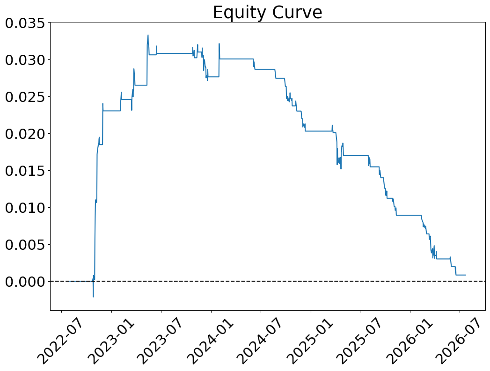

# Kalman Filter Pairs Trading — IUSB / JCPB Bond ETFs

A dynamic hedge-ratio extension of my static OLS pairs trading strategy
on the same two bond ETFs (IUSB and JCPB). A Kalman filter estimates a time-varying
hedge ratio, which defines a spread and a rolling z-score of that spread used to
generate trading signals. Signal rules and cost assumptions are identical to the
static version, so the two can be compared directly.

## Methodology

- **Universe:** IUSB (iShares Core Total USD Bond Market ETF) and JCPB
(JPMorgan Core Plus Bond ETF). The pair's cointegration was validated with the
Engle-Granger test in the static pairs project.
- **Hedge ratio:** Kalman filter with a random-walk state, updated once per day
  * State equation: `beta_t = beta_(t-1) + w_t`, with `w_t ~ N(0, Q)`
  * Observation equation: `IUSB_t = beta_t * JCPB_t + v_t`, with `v_t ~ N(0, R)`
  * Initialised from a static OLS fit: starting beta is the OLS slope and `R` is the
    OLS residual variance. `Q = 1e-5 * R` (slow-moving beta) and `P_0 = 1`
  * The state-space model has no intercept, so beta tracks close to the ETFs' price
    ratio (about 1) rather than the OLS value of 0.8852 from the static project
- **Spread:** `spread = IUSB - beta_t * JCPB`, using that day's filtered beta
- **Signal:** Rolling 60-day z-score of the spread
  * Enter short spread when z-score > +2
  * Enter long spread when z-score < -2
  * Exit to flat when |z-score| < 0.5
  * Otherwise, carry the existing position forward
- **Backtest:** Position sized in dollar-notional terms ($10,000), with
transaction costs (5bps per leg) applied on every position change and
expressed in the same return-space units as PnL. Performance evaluated
via Sharpe ratio, max drawdown, and win rate, with results segmented by
period to check for regime dependence.

## Results

| Period                   | Win Rate (Kalman) | Win Rate (static OLS) |
| ------------------------ | ----------------- | --------------------- |
| 2022-01-01 to 2023-12-31 | 40.74%            | 50.00%                |
| 2024-01-01 to present    | 8.06%             | 31.11%                |

| Metric       | Kalman | Static OLS |
| ------------ | ------ | ---------- |
| Sharpe Ratio | -0.60  | 0.07       |
| Max Drawdown | 0.05   | 0.02       |

<!-- Add after re-running the notebook and saving the equity curve:

-->

The dynamic hedge ratio did not improve on the static version: it was worse on every
metric above. The filtered beta drifts from roughly 1.007 to 0.983 as JCPB pulls ahead
of IUSB from 2024, so the filter does track the changing relationship, but the strategy
still loses its edge in the post-rate-hike low-volatility regime. The likely cause is
that quieter spreads trigger trades whose gross profit is too small to cover transaction
costs, which points to the entry rules and cost model rather than the hedge ratio
estimate (a hypothesis not yet tested directly). See the notebook for the full
interpretation and next steps.

## Stack

Python · pandas · NumPy · statsmodels · yfinance · matplotlib

## Run it

```bash
pip install -r requirements.txt
jupyter notebook KALMAN.ipynb
```

Data is downloaded from Yahoo Finance at run time, taking the most recent 1000 trading
days, so results will shift slightly depending on the date the notebook is run.
